<h1>
  <picture>
    <source media="(max-width: 540px) and (prefers-reduced-motion: reduce)" srcset="assets/capa-terminal-dragao-mobile.svg">
    <source media="(prefers-reduced-motion: reduce)" srcset="assets/capa-terminal-dragao.svg">
    <source media="(max-width: 540px)" srcset="assets/capa-terminal-holograma-mobile.svg">
    
  </picture>
</h1>

## Sobre mim

Sou o Renato, estudante de **Análise e Desenvolvimento de Sistemas na FIAP**. Meu sonho é trabalhar com **cibersegurança**.

Nos projetos em equipe da faculdade, venho praticando desenvolvimento web, Python e banco de dados.

## Tecnologias que estudo e uso

  
  
  
  

  
  
  
  

## Projetos em equipe

### [Acesso Já](https://github.com/EUGP2/python-gs)

Aplicação em Python para registrar e acompanhar problemas urbanos pelo terminal. Trabalhei com login, denúncias anônimas, confirmações da comunidade e histórico de atendimento.

### [SoulPass](https://github.com/SoulPass-1TDSPJ/Challenge-PYTHON)

Protótipo acadêmico de um cartão de transporte com pontos e recompensas. Contribuí com a versão Python, que demonstra cadastro, embarques e resgates, com persistência em Oracle e exportação em JSON.

### [Portal de Locais Acessíveis](https://github.com/1TDSPJ-26/portal-locais-acessiveis/pull/174)

Portal colaborativo de locais e serviços acessíveis. Implementei a página de favoritos, o acesso pelo menu e o ajuste de foco ao remover um local dos favoritos.
