<h1>
  <picture>
    <source media="(max-width: 540px) and (prefers-reduced-motion: reduce)" srcset="assets/capa-terminal-dragao-mobile.svg">
    <source media="(prefers-reduced-motion: reduce)" srcset="assets/capa-terminal-dragao.svg">
    <source media="(max-width: 540px)" srcset="assets/capa-terminal-giro-mobile.svg">
    
  </picture>
</h1>

## Sobre mim

Sou o Renato, estudante de **Análise e Desenvolvimento de Sistemas na FIAP**. Quero seguir carreira em **cibersegurança**.

- Gosto de **trabalhar em equipe**, trocar ideias e resolver problemas junto.
- Curto aprender coisas novas, **aprendo rápido** e pergunto quando fico com alguma dúvida.
- No tempo livre, eu gosto de jogar, ouvir música e ler.

  
  

## Tecnologias que estudo e uso

  
  
  
  

  
  
  
  

## Projetos em equipe

<h3></h3>

`Python` `JSON` · Global Solution da FIAP

Aplicação em Python para registrar e acompanhar problemas urbanos pelo terminal. Trabalhei com login, denúncias anônimas, confirmações da comunidade e histórico de atendimento.

<h3></h3>

`Python` `Oracle` · FIAP Challenge

Protótipo acadêmico de um cartão de transporte com pontos e recompensas. Contribuí com a versão Python, que demonstra cadastro, embarques e resgates, com persistência em Oracle e exportação em JSON.
